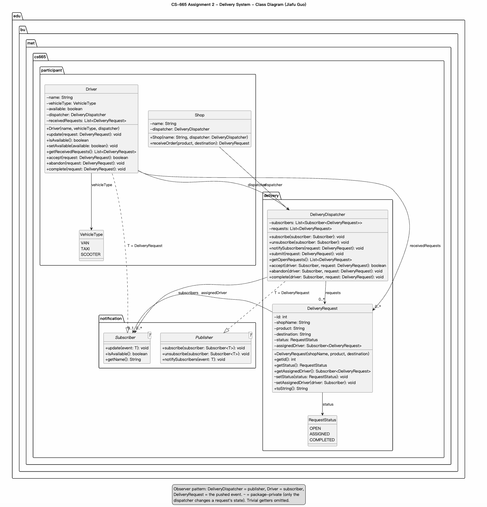

| CS-665       | Software Design & Patterns |
|--------------|----------------------------|
| Name         | Jiafu Guo                  |
| Date         | 10/20/2026                 |
| Course       | Fall 2026                  |
| Assignment # | 2                          |

# Assignment Overview

A group of retailers in a busy city deliver products with local freelance van, taxi and
scooter drivers. This project is the notification system behind that collaboration: when a
shop receives a product order from a customer, a delivery request is generated and sent to
all available drivers. As an extension, drivers can accept a request (first come, first
served), abandon it (the request is broadcast again) or complete it, and the system keeps
the state of every request.

There is no graphical or command line user interface. The user interactions are implemented
as sequences of JUnit tests, as required by the assignment; `Main` only runs a short console
demo using Log4j output.

# GitHub Repository Link:
https://github.com/guojiafu-jeff/cs-665-assignment-2

# Implementation Description

## Design overview

The code is organized in three packages that mirror the three ideas of the problem:

| Package | Classes | Responsibility |
|---|---|---|
| `edu.bu.met.cs665.notification` | `Publisher<T>`, `Subscriber<T>` (interfaces) | The two roles of the Observer pattern, independent of deliveries. |
| `edu.bu.met.cs665.delivery` | `DeliveryRequest`, `RequestStatus` (enum), `DeliveryDispatcher` | The request itself, its life cycle, and the central dispatch center. |
| `edu.bu.met.cs665.participant` | `Shop`, `Driver`, `VehicleType` (enum) | The two kinds of participants. |

All shops and drivers share one `DeliveryDispatcher`. Shops never talk to drivers directly:

```java
DeliveryDispatcher dispatcher = new DeliveryDispatcher();
Shop shop = new Shop("Corner Shop", dispatcher);
Driver ann = new Driver("Ann", VehicleType.VAN, dispatcher);   // subscribes itself
// ... four more drivers ...
DeliveryRequest request = shop.receiveOrder("2 kg apples", "12 Main St"); // broadcast
ann.accept(request);      // true: request is ASSIGNED to Ann, Ann is busy
ann.abandon(request);     // request is OPEN again and broadcast once more
```

How the classes work together:

- `Shop.receiveOrder()` creates a `DeliveryRequest` and hands it to `DeliveryDispatcher.submit()`.
- `DeliveryDispatcher` registers the request as OPEN and calls `notifySubscribers()`, which
  pushes the request to every subscriber whose `isAvailable()` is true. The dispatcher only
  knows the `Subscriber` interface, never the `Driver` class.
- `Driver.update()` stores the request in the driver's list of received requests.
- `Driver.accept()`, `abandon()` and `complete()` report back to the dispatcher, which is the
  only place that changes a request's state (`DeliveryRequest`'s setters are package-private).
  The driver is responsible for its own availability flag: busy after accepting, free again
  after completing or abandoning, and it can go off duty with `setAvailable(false)`.

Request life cycle: OPEN → ASSIGNED (accept) → COMPLETED (complete); ASSIGNED → OPEN
(abandon, followed by a new broadcast). COMPLETED is final.

Errors: `accept()` returns `false` when the request is no longer OPEN, because being beaten
by another driver is a normal outcome. `abandon()` and `complete()` throw
`IllegalStateException` when the caller is not the assigned driver, and all methods throw
`IllegalArgumentException` for null arguments or unknown requests. A rejected call leaves the
request and the drivers unchanged.

## Assumptions

1. All shops and drivers share one dispatch center; the dispatcher is created once and passed
   to every shop and driver (no Singleton, so every test can use a fresh instance).
2. A request is handled by exactly one driver at a time; the first driver to accept gets it.
3. A driver's availability is a switch: drivers can go on or off duty, become busy
   automatically after accepting, and become free again after completing or abandoning.
4. A broadcast reaches only the drivers available at that moment. If no driver is available
   the request stays OPEN and can be found with `getOpenRequests()`.
5. Abandoning a request broadcasts it again to the drivers available at that moment.
   Completing is final.
6. Shops do not receive notifications; they follow a request through its status. Letting
   shops subscribe as well is a possible extension, since the publisher only needs the
   `Subscriber` interface.
7. The vehicle type (van, taxi, scooter) is a property of a driver; all drivers behave the
   same way, so it is an enum, not a class hierarchy.
8. Every request gets a unique id from a shared counter; ids are for logs and tests, the
   program itself identifies requests by object.

## Flexibility

- A new kind of subscriber (a shop that wants updates, a drone fleet) only implements
  `Subscriber<DeliveryRequest>`; `DeliveryDispatcher` does not change, because it depends on
  the interface only.
- A new vehicle type is one new constant in `VehicleType`.
- Shops and drivers never reference each other, so either side can change independently.
- The request life cycle lives in one class (`DeliveryDispatcher`) and one enum
  (`RequestStatus`); adding a state such as CANCELLED touches only those two.
- The `notification` package is generic (`Publisher<T>`, `Subscriber<T>`) and can be reused
  for any other event type.

## Simplicity and understandability

- Three packages mirror the three ideas: the notification mechanism, the delivery domain,
  the participants; package dependencies go in one direction only
  (participant → delivery → notification).
- The public API reads like the story: `shop.receiveOrder`, `driver.accept`,
  `driver.abandon`, `driver.complete`.
- Every file and method has a documentation comment that says what it does and where it is
  used; the request's `toString()` makes log lines and test failures readable.

## Avoiding duplicated code

- Broadcasting exists once, in `notifySubscribers()`; both `submit()` and `abandon()` call it.
- The checks "arguments present and request known" and "request assigned to this driver"
  exist once each (`requireKnown()`, `requireAssignedTo()`) and are shared by `accept()`,
  `abandon()` and `complete()`.
- `Driver.accept()`, `abandon()` and `complete()` are one-line delegations to the dispatcher
  plus the driver's own availability flag; the rules are not repeated on the driver side.

Why it matters: a rule that lives in one place is changed in one place, behaves the same
everywhere and is tested once, which means fewer bugs.

## Design patterns

- **Observer** (publish/subscribe): `Publisher<T>` and `Subscriber<T>` are the two roles,
  `DeliveryDispatcher` is the publisher, `Driver` is the subscriber and `DeliveryRequest` is
  the pushed event. It was chosen because the problem is exactly the one the pattern solves:
  one event must reach a varying number of receivers, and the sender must not depend on who
  they are. The push style means drivers are informed immediately, without polling.
- The dispatcher also coordinates shops and drivers so that they never reference each other;
  this resembles the Mediator pattern, which has not been covered in class yet, so it is
  mentioned here only as a resemblance.

## Tests

`TestDeliverySystem` plays the user scenarios with one shop and five drivers:

- the required scenario: one request is broadcast and all five drivers receive it;
- an off-duty driver and an unsubscribed driver are not notified;
- accepting is first come, first served and makes the winner busy;
- abandoning reopens the request, frees the driver and broadcasts again;
- completing is final; only the assigned driver may abandon.

## Use of AI assistance

The use of AtomicInteger was suggested by Claude. I also used it to help me write PlantUML code to get a clear UML graph and format the readme file.

# UML Class Diagram



The same diagram as a PDF: [uml/UML.pdf](uml/UML.pdf). Observer pattern: `DeliveryDispatcher` is the publisher, `Driver` the subscriber, `DeliveryRequest` the pushed event.

# Maven Commands

This project uses Java 25. Install a Java 25 JDK and Apache Maven (https://maven.apache.org/) before building. Maven must run with JDK 25 or newer; check the selected versions with:

```bash
java -version
mvn -version
```

The Maven compiler is configured with `maven.compiler.release` set to `25`, so the code can use Java 25 language features and APIs and produces bytecode requiring Java 25 or newer.

If compilation fails with `release version 25 not supported`, Maven is running with a JDK older than 25. Check `mvn -version` (not only `java -version`), then configure `JAVA_HOME` to point to JDK 25 and ensure its `bin` directory is first on `PATH`. On macOS, for example, run these commands in the terminal you use for Maven:

```bash
export JAVA_HOME="$(/usr/libexec/java_home -v 25)"
export PATH="$JAVA_HOME/bin:$PATH"
mvn -version
mvn clean verify
```

Confirm that `mvn -version` reports Java 25 or newer. Open a new terminal in your IDE after changing the JDK environment so it picks up the updated setting.

### Java 25 features to explore

Java 25 is an LTS release. In addition to the language and API improvements from intervening Java releases, these finalized Java 25 features can be useful in coursework:

- **Compact source files and instance `main` methods:** for a small program, Java 25 lets you omit the class declaration and the `public static` modifiers. The Java launcher can infer the entry point:

  ```java
  // Before: a named class and static main method were required.
  public class Hello {
      public static void main(String[] args) {
          System.out.println("Hello, Java!");
      }
  }
  ```

  ```java
  // Java 25: save as Hello.java and run with `java Hello.java`.
  void main() {
      System.out.println("Hello, Java 25!");
  }
  ```

- **Module import declarations:** instead of listing multiple packages from one module, Java 25 can import all packages that module exports. For example, `java.base` exports `java.util` and `java.io`:

  ```java
  // Before:
  import java.util.List;
  import java.util.Map;

  class CourseList {
      public static void main(String[] args) {
          Map<String, List<String>> courses = Map.of("CS", List.of("Java", "Design"));
          System.out.println(courses);
      }
  }
  ```

  ```java
  // Java 25:
  import module java.base;

  void main() {
      Map<String, List<String>> courses = Map.of("CS", List.of("Java", "Design"));
      System.out.println(courses);
  }
  ```

- **Flexible constructor bodies:** previously, validation that had to happen before a superclass constructor call was often hidden in a helper used as a `super(...)` argument. Java 25 allows a constructor to validate arguments directly before `super()`; this early code cannot access the object under construction:

  ```java
  // Before (assume BaseItem has a constructor that accepts a name):
  class BaseItem {
      BaseItem(String name) {}
  }

  class NamedItem extends BaseItem {
      private final String name;

      NamedItem(String name) {
          super(validate(name));
          this.name = name;
      }

      private static String validate(String name) {
          if (name == null || name.isBlank()) {
              throw new IllegalArgumentException("name must not be blank");
          }
          return name;
      }
  }
  ```

  ```java
  // Java 25:
  class BaseItem {
      BaseItem(String name) {}
  }

  class NamedItem extends BaseItem {
      private final String name;

      NamedItem(String name) {
          if (name == null || name.isBlank()) {
              throw new IllegalArgumentException("name must not be blank");
          }
          super(name);
          this.name = name;
      }
  }
  ```

- **Scoped values:** before scoped values, `ThreadLocal` was a common way to make per-thread context available to deeper calls, but required mutable set/cleanup discipline. A scoped value is immutable once bound and is available only during the bounded operation:

  ```java
  // Before:
  class RequestExample {
      private static final ThreadLocal<String> REQUEST_ID = new ThreadLocal<>();

      static void main(String[] args) {
          handleRequest();
      }

      private static void handleRequest() {
          REQUEST_ID.set("request-123");
          try {
              processRequest();
          } finally {
              REQUEST_ID.remove();
          }
      }

      private static void processRequest() {
          System.out.println("Handling " + REQUEST_ID.get());
      }
  }
  ```

  ```java
  // Java 25:
  class RequestExample {
      private static final ScopedValue<String> REQUEST_ID = ScopedValue.newInstance();

      static void main(String[] args) {
          ScopedValue.where(REQUEST_ID, "request-123").run(RequestExample::handleRequest);
      }

      private static void handleRequest() {
          processRequest();
      }

      private static void processRequest() {
          System.out.println("Handling " + REQUEST_ID.get());
      }
  }
  ```

Some Java 25 features are still in preview or incubator status. They require explicit opt-in and may change in later releases; this template uses standard Java 25 features without preview flags.

## Log4j example

The template includes Log4j 2 and a working example in `Main.java`. A class gets a logger with `LogManager.getLogger`; choose a level that matches the message:

```java
// Declare once as a class field.
private static final Logger LOGGER = LogManager.getLogger(Main.class);

// Call from a method.
LOGGER.debug("Details useful during development.");
LOGGER.info("The operation completed.");
LOGGER.warn("The input is unusual, but processing can continue.");

// In a catch block, pass the caught exception to include its stack trace.
LOGGER.error("The operation failed.", exception);
```

Log levels help filter output: `TRACE` and `DEBUG` are useful for detailed diagnostics, `INFO` for normal events, `WARN` for unexpected conditions, and `ERROR` for failures. The sample configuration in `src/main/resources/log4j2.xml` writes messages at `DEBUG` level and above to the console. Change the root logger's `level` to `info` to hide debug messages, or adjust the appender and layout to customize where and how messages are displayed.

Run the example with:

```bash
mvn exec:java
```

Apache Maven is a build automation tool and a project management tool for Java-based projects. Maven provides a standardized way to build, package, and deploy Java applications.

Maven uses a Project Object Model (POM) file to manage the build process and its dependencies. The POM file contains information about the project, such as its dependencies, the build configuration, and the plugins used for building and packaging the project.

Maven provides a centralized repository for storing and accessing dependencies, which makes it easier to manage the dependencies of a project. It also provides a standardized way to build and deploy projects, which helps to ensure that builds are consistent and repeatable.

Maven also integrates with other development tools, such as IDEs and continuous integration systems, making it easier to use as part of a development workflow.

Maven provides a large number of plugins for various tasks, such as compiling code, running tests, generating reports, and creating JAR files. This makes it a versatile tool that can be used for many different types of Java projects.

## Compile
Type on the command line:

```bash
mvn clean compile
```


## JUnit Tests
JUnit is a popular testing framework for Java. JUnit tests are automated tests that are written to verify that the behavior of a piece of code is as expected.

In JUnit, tests are written as methods within a test class. Each test method tests a specific aspect of the code and is annotated with the @Test annotation. JUnit provides a range of assertions that can be used to verify the behavior of the code being tested.

JUnit tests are executed automatically and the results of the tests are reported. This allows developers to quickly and easily check if their code is working as expected, and make any necessary changes to fix any issues that are found.

The use of JUnit tests is an important part of Test-Driven Development (TDD), where tests are written before the code they are testing is written. This helps to ensure that the code is written in a way that is easily testable and that all required functionality is covered by tests.

JUnit tests can be run as part of a continuous integration pipeline, where tests are automatically run every time changes are made to the code. This helps to catch any issues as soon as they are introduced, reducing the need for manual testing and making it easier to ensure that the code is always in a releasable state.

To run, use the following command:
```bash
mvn clean test
```

## Test coverage

JaCoCo records which parts of the application are exercised by the tests and creates an HTML coverage report. Run the tests and generate the report with:

```bash
mvn clean verify
```

Open `target/site/jacoco/index.html` in a browser to see coverage by package, class, and method. The report includes instruction, branch, and line coverage. Click a class name to see which lines were executed; red lines are not covered, and yellow lines were only partly covered.

For example, add tests for different age-calculation paths in `Person` and run `mvn clean verify` again. The report will show whether the new tests exercised those paths. Coverage is a guide to which code your tests execute, not proof that the code is correct: review the assertions and edge cases as well.


## Spotbugs

SpotBugs is a static code analysis tool for Java that detects potential bugs in your code. It is an open-source tool that can be used as a standalone application or integrated into development tools such as Eclipse, IntelliJ, and Gradle.

SpotBugs performs an analysis of the bytecode generated from your Java source code and reports on any potential problems or issues that it finds. This includes things like null pointer exceptions, resource leaks, misused collections, and other common bugs.

The tool uses data flow analysis to examine the behavior of the code and detect issues that might not be immediately obvious from just reading the source code. SpotBugs is able to identify a wide range of issues and can be customized to meet the needs of your specific project.

Using SpotBugs can help to improve the quality and reliability of your code by catching potential bugs early in the development process. This can save time and effort in the long run by reducing the need for debugging and fixing issues later in the development cycle. SpotBugs can also help to ensure that your code is secure by identifying potential security vulnerabilities.

Use the following command:

```bash
mvn spotbugs:gui 
```

For more info see
https://spotbugs.readthedocs.io/en/latest/maven.html

SpotBugs https://spotbugs.github.io/ is the spiritual successor of FindBugs.


## Checkstyle

Checkstyle is a development tool for checking Java source code against a set of coding standards. It is an open-source tool that can be integrated into various integrated development environments (IDEs), such as Eclipse and IntelliJ, as well as build tools like Maven and Gradle.

Checkstyle performs static code analysis, which means it examines the source code without executing it, and reports on any issues or violations of the coding standards defined in its configuration. This includes issues like code style, code indentation, naming conventions, code structure, and many others.

By using Checkstyle, developers can ensure that their code adheres to a consistent style and follows best practices, making it easier for other developers to read and maintain. It can also help to identify potential issues before the code is actually run, reducing the risk of runtime errors or unexpected behavior.

Checkstyle is highly configurable and can be customized to fit the needs of your team or organization. It supports a wide range of coding standards and can be integrated with other tools, such as code coverage and automated testing tools, to create a comprehensive and automated software development process.

In this template, Checkstyle is informational: violations are reported, but they do not fail the Maven build. This behavior is controlled by the `failOnViolation` setting in the `maven-checkstyle-plugin` configuration in `pom.xml`, which is currently set to `false`. Review and fix the reported issues as part of your work; a successful build does not necessarily mean that the Checkstyle checks passed.

To make Checkstyle violations fail the build, change that setting to `true`:

```xml
<configuration>
    <configLocation>config/google_checks.xml</configLocation>
    <failOnViolation>true</failOnViolation>
    <consoleOutput>true</consoleOutput>
</configuration>
```

Then run the Checkstyle check explicitly:

```bash
mvn checkstyle:check
```

With this configuration, the check goal fails when it finds violations. The report-generation command below remains useful for reviewing the detailed results.

The following command will generate a report in HTML format that you can open in a web browser.

```bash
mvn checkstyle:checkstyle
```

The HTML page will be found at the following location:
`target/site/checkstyle.html`

## Run the demo

`Main` runs a short console demo (one shop, five drivers, one request that is accepted,
abandoned, broadcast again and completed), using Log4j for the output:

```bash
mvn compile exec:java
```

The tests of this assignment are in `src/test/java/edu/bu/met/cs665/TestDeliverySystem.java`.